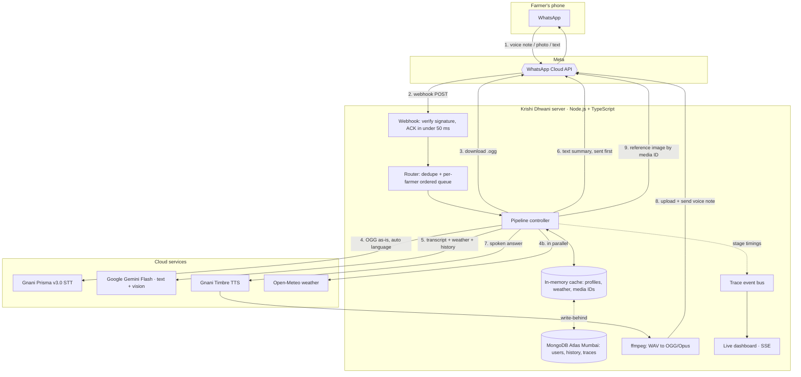

# Krishi Dhwani · कृषि ध्वनि

**A WhatsApp voice assistant for Indian farmers. Send a voice note in your language and get expert crop advice back as a voice note, a text summary and a reference photo, in about 4 seconds.**

Built for the [Gnani.ai Great Indian AI Internship Challenge](https://www.gnani.ai/internship) on **Gnani Prisma (speech-to-text)** and **Gnani Timbre (text-to-speech)**.

> **Status:** technical specification. This repository holds the product and engineering spec; the implementation follows it task by task.

---

## Contents

1. [The problem](#1-the-problem)
2. [The solution](#2-the-solution)
3. [Why it is different](#3-why-it-is-different)
4. [Features in v1](#4-features-in-v1)
5. [How it works](#5-how-it-works)
6. [How we use Gnani](#6-how-we-use-gnani)
7. [Supported languages](#7-supported-languages)
8. [Tech stack](#8-tech-stack)
9. [Latency design](#9-latency-design)
10. [Conversation flows](#10-conversation-flows)
11. [The AI brain (Gemini)](#11-the-ai-brain-gemini)
12. [Live pipeline dashboard](#12-live-pipeline-dashboard)
13. [Data model](#13-data-model)
14. [API contracts](#14-api-contracts)
15. [Configuration](#15-configuration)
16. [Project structure](#16-project-structure)
17. [Quality, evaluation and noise robustness](#17-quality-evaluation-and-noise-robustness)
18. [Security, privacy and safety](#18-security-privacy-and-safety)
19. [Deployment](#19-deployment)
20. [Roadmap](#20-roadmap)
21. [Hackathon fit](#21-hackathon-fit)
22. [Team](#22-team)

---

## 1. The problem

India has more than 140 million farm holdings, most of them small. When a crop gets sick, a farmer needs an answer **today**: the right spray, the right dose, and whether tomorrow's rain will wash it off. Today the options are poor:

- **Extension officers** are few and far away.
- **IVR helplines** need menu navigation ("press 1 for Hindi"), drop on weak networks, and feel robotic.
- **Apps and websites** assume literacy, English or Hindi, and a good data connection.
- **Real-time voice bots** (WebRTC, phone calls) break on patchy 2G/3G networks: they lag, cut out and talk over the farmer.

Yet nearly every farmer already uses **WhatsApp voice notes** every day.

## 2. The solution

Krishi Dhwani lives on a WhatsApp number. The farmer holds the mic and speaks naturally, in their own language and dialect, mixing languages if they like. In about 4 seconds the chat shows:

1. A **short text summary** they can come back to later, with doses and units. It arrives first.
2. A **voice note** in a natural Indian voice that explains what to do, why, and what to watch out for.
3. A **reference photo** when relevant ("Compare: do your leaves look like this?").

The farmer can also send a **photo of a sick plant** for diagnosis, or **share their location** once so every answer accounts for the **local weather forecast**.

## 3. Why it is different

| | IVR / phone bots | Farming apps | **Krishi Dhwani** |
|---|---|---|---|
| Works on 2G/3G | Poor (real-time audio) | Poor | **Yes. Asynchronous voice notes upload when the network allows** |
| Onboarding | DTMF menus | Sign-up and forms | **None. Language auto-detected from the first voice note** |
| Literacy needed | No | Yes | **No (voice in, voice out)** |
| Answer you can keep | No | Sometimes | **Yes: text + voice + photo in one thread** |
| Code-mixed speech | Rarely | No | **Yes (Hinglish and others)** |
| Weather-aware advice | No | Sometimes | **Yes, automatically** |

**Asynchronous over synchronous.** A 3–4 second wait feels natural in a chat but awkward on a call. Voice notes survive network drops, so there is no real-time streaming to fail.

## 4. Features in v1

- 🎙️ **Voice in, voice out** in 10 Indian languages plus Hinglish, with automatic language detection.
- 📝 **Text summary first**, voice note second, so the perceived wait stays short.
- 🌦️ **Live weather in answers**: 3-day local forecast (rain chance, temperature, humidity) changes spraying, irrigation and fertilizer advice.
- 📷 **Crop photo diagnosis**: send a photo and get the likely problem, the action and a caution in your language.
- 🖼️ **Reference images**: a curated, openly licensed library of ~25 common Indian crop diseases and pests, sent alongside the answer for comparison.
- 🧠 **Memory per farmer**: language, crops and location remembered against the phone number, plus a short conversation history for follow-ups.
- 🔁 **Language switch anytime**: say or type "भाषा" / "language" to get a WhatsApp list picker.
- 📊 **Live pipeline dashboard**: every request shown flowing through download → STT → LLM → TTS → delivery with per-stage timings.
- 🛡️ **Safe advice**: integrated pest management first, label doses only, no banned pesticides, and escalation to the Krishi Vigyan Kendra / Kisan Call Centre when unsure.

## 5. How it works



### Request lifecycle (voice note)

1. **Webhook**: Meta POSTs the event. We check `X-Hub-Signature-256`, reply `200` immediately, and do the rest in the background.
2. **Acknowledge**: react with 🎧, mark as read, and show the typing indicator, so the farmer knows we heard them.
3. **Profile**: language, crops and location from the in-memory cache (MongoDB behind it).
4. **Download + weather in parallel**: fetch the voice note from Meta while the weather forecast loads (cached for 30 minutes).
5. **Speech-to-text**: the **original OGG** goes to Gnani Prisma v3.0 with `indic-auto`. There is no inbound transcoding. We get the transcript and the detected language.
6. **Reasoning**: Gemini Flash gets the transcript, profile, weather and the last 6 turns, and returns structured JSON: spoken answer, text summary, reference image key, language and flags.
7. **Text first**: the summary is sent at once.
8. **Voice**: in parallel, Gnani Timbre synthesizes the spoken answer → ffmpeg encodes OGG/Opus mono → upload → send as a voice note.
9. **Image**: the matching reference photo, pre-uploaded at boot, is sent by media ID.
10. **Write-behind**: history, crops and the trace are saved without slowing the reply.

## 6. How we use Gnani

| Gnani product | Endpoint | How we use it | Why Gnani |
|---|---|---|---|
| **Prisma v3.0 STT** | `POST https://api.vachana.ai/stt/v3` (multipart) | Transcribe farmer voice notes. `language_code=indic-auto` detects the language, so there are no menus. OGG accepted directly. Notes over 30 s are split into 25 s chunks transcribed in parallel. | Trained on Indian languages and code-mixed speech, robust to narrow-band phone audio and field noise (tractors, wind) |
| **Timbre v2.5 TTS** (v3.0 switchable) | `POST https://api.vachana.ai/api/v1/tts/inference` (JSON → WAV) | Generate the reply voice note in the farmer's language with a native-sounding voice per language, including a dedicated Hinglish voice | Indian prosody: sounds like a trusted local expert, not a western robot |
| **Timbre SSE** | `POST https://api.vachana.ai/api/v1/tts/sse` | Latency optimisation: stream audio chunks straight into the encoder | Encoding overlaps synthesis |

All calls use `X-API-Key-ID` authentication, keep-alive connections, timeouts and one retry on `429`/`5xx`. Synthesized replies are cached by `hash(language + voice + text)`, so repeated answers cost no credits and no time.

## 7. Supported languages

All languages supported by Gnani Prisma STT, plus Hinglish through Timbre's dedicated Hinglish voice.

| Language | Code | Script | STT | Reply voice (Timbre v2.5) |
|---|---|---|---|---|
| Hindi | `hi-IN` | Devanagari | ✅ | Nalini (F) / Deepak (M) |
| English (Indian) | `en-IN` | Latin | ✅ | Kaveri (F) / Pranav (M) |
| Hinglish (code-mixed) | `hi-en` | Latin | ✅ via `en-IN` (English-Hindi mixed) | Poorvi (F) |
| Bengali | `bn-IN` | Bengali | ✅ | Kirra (F) / Dhruva (M) |
| Gujarati | `gu-IN` | Gujarati | ✅ | Falak (F) / Veera (M) |
| Kannada | `kn-IN` | Kannada | ✅ | Saanvi (F) / Kavin (M) |
| Malayalam | `ml-IN` | Malayalam | ✅ | Reshma (F) / Riyaan (M) |
| Marathi | `mr-IN` | Devanagari | ✅ | Zahira (F) / Ishaan (M) |
| Punjabi | `pa-IN` | Gurmukhi | ✅ | Mehuli (F) / Zayan (M) |
| Tamil | `ta-IN` | Tamil | ✅ | Asmita (F) |
| Telugu | `te-IN` | Telugu | ✅ | Suhana (F) |

**Language logic:** the first voice note sets the farmer's language. After that, a change is accepted only when the detected language differs in two consecutive messages, so a single misdetection on a short note does not flip it. Choosing a language from the menu locks it.

## 8. Tech stack

| Layer | Choice |
|---|---|
| Runtime | Node.js 22 LTS, TypeScript (strict), ESM |
| Web server | Express 5 (raw body for webhook signatures) |
| HTTP | Built-in `fetch` (undici) with keep-alive, `AbortSignal.timeout` on every call |
| Messaging | Meta WhatsApp Cloud API (Graph API) |
| Speech-to-text | Gnani Prisma v3.0 (REST) |
| Text-to-speech | Gnani Timbre v2.5 / v3.0 (REST, SSE) |
| LLM + vision | Google Gemini Flash via `@google/genai`, JSON structured output, minimal thinking |
| Weather | Open-Meteo forecast + geocoding (free, no key) |
| Audio | `ffmpeg-static` over stdin/stdout pipes (no temp files), `music-metadata` for duration |
| Database | MongoDB Atlas (Mumbai region), official driver |
| Hot cache | `lru-cache` (profiles, weather, dedupe, media IDs) |
| Validation | `zod` (env, webhook payloads, LLM output) |
| Logging | `pino` (phone numbers always masked) |
| Dashboard | Static HTML + vanilla JS + Server-Sent Events |
| Tests | `vitest`, undici `MockAgent` |
| Deploy | Docker on Fly.io, region `bom` (Mumbai), always-on machine |

## 9. Latency design

**Goal: farmer sees the text summary in ≤ 2.5 s and hears the voice note in ≤ 4 s (p50, 10-second voice note).**

| # | Stage | Budget | Technique |
|---|---|---|---|
| 0 | Webhook → `200 OK` | < 50 ms | ACK before any processing |
| 1 | 🎧 reaction + typing indicator | async | Instant feedback |
| 2 | Profile lookup | ~1 ms | In-memory LRU; MongoDB only on a miss |
| 3 | Media download | 300–600 ms | Keep-alive; weather fetched **in parallel** |
| 4 | Gnani STT | 400–900 ms | Original OGG sent as-is (no transcode); long notes chunked in parallel |
| 5 | Gemini | 700–1300 ms | Flash tier, thinking off, JSON schema, short answers, 6-turn history |
| 6 | Send text | 150–300 ms | Sent **before** TTS finishes |
| 7 | Gnani TTS | 400–900 ms | Runs in parallel with step 6; hash cache; SSE streaming as an optimisation |
| 8 | Encode OGG/Opus | 50–120 ms | ffmpeg via pipes, 24 kbps VoIP profile (small file for 2G) |
| 9 | Upload + send voice | 300–500 ms | |
| 10 | Reference image | 150–300 ms | Pre-uploaded at boot, sent by media ID |
| — | DB writes | 0 ms on path | Write-behind |

Other rules: one region for everything (Mumbai), TLS warm-up at boot, no cold starts (`min_machines_running = 1`), and sequential sends so WhatsApp keeps the message order (text → voice → image).

## 10. Conversation flows

| Farmer sends | Bot does |
|---|---|
| **Voice note** | STT → Gemini → text + voice + optional reference image |
| **Text** | Script detection picks the language → Gemini → text + voice |
| **Photo** (+ optional caption) | Gemini vision diagnosis → text + voice + matching reference image |
| **Location pin** | Saves the farm location → confirms with today's weather in their language |
| **"भाषा" / "language"** | WhatsApp list picker with all 11 options → locks the choice |
| **First message ever** | Answers the question first, **then** a one-line welcome and a "share location" button. No menu before the first answer |
| Sticker, video, document | Polite localized hint: "send a voice note, photo or text" |
| Voice note > 2 min | Answers the first 2 minutes and suggests shorter notes |
| Silence or noise only | "I couldn't hear that clearly, please try again" in their language |

## 11. The AI brain (Gemini)

One Gemini call per request returns a validated JSON object:

```json
{
  "reply_language": "ta-IN",
  "spoken_answer": "≤ 70 words, native script, numbers and doses written as words, no markdown",
  "text_summary": "• 2–5 short lines with doses, units and waiting period",
  "reference_image_key": "paddy_blast | … | none",
  "detected_crops": ["paddy"],
  "spoken_place": "Thanjavur",
  "needs_location": false,
  "confidence": "high | medium | low",
  "escalate": false
}
```

**Prompt principles:**

- Speak like a kind local extension officer: the single most important action first, then one reason, then one caution.
- Integrated pest management first; chemicals only at label doses with a safety interval; never banned pesticides.
- **Weather-aware**: if rain is likely within 24–48 h, don't spray or top-dress now; say when to do it instead.
- Numbers spelled out in the spoken answer so TTS reads them naturally; digits allowed in the text summary.
- Unsure, outbreak, livestock or poisoning → `escalate=true` → points to the Krishi Vigyan Kendra / Kisan Call Centre (1800-180-1551).
- No invented scheme amounts or mandi prices; ignores prompt-injection attempts inside farmer messages.
- Output is checked for the right Unicode script and retried once if the language is wrong.

**Context given to the model:** reply language, farmer profile (crops, location), 72-hour weather line, allowed reference image keys, last 6 turns, and the transcript, marked as possibly containing recognition errors.

## 12. Live pipeline dashboard

`/dashboard` (token protected) shows the system working in real time. It is built for judges, demo videos and debugging.

- **KPI row:** p50 time-to-text, p50 time-to-voice, p50 per stage (STT, LLM, TTS), error rate, requests today.
- **Live waterfall:** one row per request, with animated bars for download → STT → weather → LLM → send text → TTS → encode → upload → send voice → send image, and markers where text and voice were delivered.
- **Language distribution** and a live event log.
- Phone numbers are always masked (`91•••••••678`). Transcripts are hidden unless demo mode is on.

Under the hood every stage emits a `TraceEvent { traceId, user, kind, stage, status, t, ms, meta }` to an in-process bus, streamed over Server-Sent Events. `/api/stats` serves p50/p95 per stage over the last 200 requests.

## 13. Data model

| Collection | Key | Contents | Retention |
|---|---|---|---|
| `users` | WhatsApp ID | language, language-locked flag, location (pin or spoken), crops, message count | until deleted |
| `turns` | `{userId, at}` | role, text, language, kind | 90 days (TTL) |
| `processed` | WhatsApp message ID | dedupe across restarts | 2 days (TTL) |
| `media_cache` | sha256 of (language, voice, text) or image key | WhatsApp media ID | 25 days (TTL) |
| `traces` | message ID | stage timings for the dashboard | 7 days (TTL) |

## 14. API contracts

### Our endpoints

| Method | Path | Purpose |
|---|---|---|
| `GET` | `/webhook` | Meta verification (`hub.mode`, `hub.verify_token`, `hub.challenge`) |
| `POST` | `/webhook` | WhatsApp events; HMAC-SHA256 signature required |
| `GET` | `/healthz` | Liveness |
| `GET` | `/dashboard` | Live dashboard (token) |
| `GET` | `/events` | SSE stream of trace events (token) |
| `GET` | `/api/stats` | Aggregated latency, language and error stats (token) |

### WhatsApp Cloud API calls we make

| Call | Endpoint |
|---|---|
| Get media URL / download | `GET /{media-id}` → `GET {url}` |
| Upload media | `POST /{phone-number-id}/media` |
| Send text / voice (`audio.voice=true`, OGG Opus) / image / reaction / list / location request | `POST /{phone-number-id}/messages` |
| Mark read + typing indicator | `POST /{phone-number-id}/messages` with `status: "read"` |

### Gnani calls we make

```bash
# Speech-to-text (auto language)
curl -X POST https://api.vachana.ai/stt/v3 \
  -H "X-API-Key-ID: $GNANI_API_KEY" \
  -F audio_file=@note.ogg -F model=prisma-v3.0 -F language_code=indic-auto

# Text-to-speech
curl -X POST https://api.vachana.ai/api/v1/tts/inference \
  -H "Content-Type: application/json" -H "X-API-Key-ID: $GNANI_API_KEY" \
  -d '{"text":"नमस्ते किसान भाई","voice":"Nalini","model":"timbre-v2.5","language":"hi-IN","speed":1.0,
       "audio_config":{"sample_rate":24000,"num_channels":1,"sample_width":2,"encoding":"linear_pcm","container":"wav"}}' \
  --output reply.wav
```

## 15. Configuration

```bash
PORT=3000
PUBLIC_BASE_URL=https://your-host
# Meta WhatsApp Cloud API
GRAPH_VERSION=v23.0
WA_PHONE_NUMBER_ID=
WA_ACCESS_TOKEN=            # System User permanent token
WA_APP_SECRET=              # for webhook signature checks
WA_VERIFY_TOKEN=
# Gnani
GNANI_API_KEY=
GNANI_BASE_URL=https://api.vachana.ai
GNANI_STT_MODEL=prisma-v3.0
GNANI_TTS_MODEL=timbre-v2.5
TTS_SAMPLE_RATE=24000
# Google Gemini
GEMINI_API_KEY=
GEMINI_MODEL=gemini-2.5-flash   # or the newest Flash model available
# Data
MONGODB_URI=
MONGODB_DB=krishi
# Dashboard
DASHBOARD_TOKEN=
# Limits
MAX_HISTORY_TURNS=6
PER_USER_RATE_PER_MIN=10
```

## 16. Project structure

```
src/
  server.ts              Express app and boot sequence
  config.ts              zod-validated environment
  webhook/               signature check, payload parsing, dedupe and per-farmer queue
  pipeline/              voice, text, image, location flows; reply sender; tracing
  brain/                 Gemini prompt, JSON schema, ask() and diagnose()
  clients/               whatsapp, gnani, weather, mongo (the only places that call the network)
  audio/                 ffmpeg encode/split, duration probe
  domain/                languages and voices, localized messages, users, history, reference images
  dashboard/             trace bus, SSE endpoint, stats
public/dashboard/        live dashboard page
assets/reference/        openly licensed crop disease images + LICENSES.md
scripts/                 smoke tests, synthetic fixture generator, offline evaluation
test/                    unit and contract tests
```

## 17. Quality, evaluation and noise robustness

- **Synthetic test set:** 30 farmer questions (3 per language + 3 Hinglish) synthesized with Gnani TTS, then degraded:
  - clean
  - field noise (tractor, wind, crowd) at ~10 dB and ~5 dB SNR
  - 8 kHz narrow-band, like a budget phone mic
- **Offline evaluator** (`scripts/eval.ts`) measures per language and noise level: language detection accuracy, character error rate, STT latency, LLM latency, and whether the reply is in the right language and script.
- **Contract tests** for every external call (URL, headers, body) with mocked HTTP; unit tests for parsing, language detection and prompt building.
- **End-to-end demo script** run from a real phone before every release: Hindi, Tamil (noisy), Hinglish, photo diagnosis, weather-aware follow-up, language switch.

Measured latency and accuracy tables will be published here once the evaluation runs.

## 18. Security, privacy and safety

- Webhook **HMAC-SHA256 signature** verification with a timing-safe compare; dashboard behind a token.
- Secrets only in environment variables; `.env` never committed.
- **Phone numbers masked** in all logs, traces and the dashboard; only hashed IDs used for analytics.
- **Synthetic data only** in the repo, tests and demo (per the challenge rules): no real phone numbers, Aadhaar, PAN or recorded calls.
- Conversation history auto-expires after 90 days.
- Idempotent processing (Meta retries are deduped) and per-farmer rate limiting.
- Agronomic safety rules in the prompt: label doses, safety intervals, no banned pesticides, escalation to human experts when unsure.
- Reference images are openly licensed, with credits in `assets/reference/LICENSES.md`.

## 19. Deployment

1. **Meta:** create a Business app → add WhatsApp → note the Phone Number ID → create a **System User permanent token** (`whatsapp_business_messaging`, `whatsapp_business_management`) → set the webhook to `https://<host>/webhook` and subscribe to `messages`.
2. **Gnani:** create an API key at [app.gnani.ai](https://app.gnani.ai/voice).
3. **Gemini:** create an API key in Google AI Studio.
4. **MongoDB Atlas:** free cluster in Mumbai (`ap-south-1`).
5. **Run locally:** `npm install && npm run dev`, expose with `cloudflared tunnel --url http://localhost:3000`.
6. **Production:** Docker image (`node:22-slim`) on Fly.io in `bom` with one always-on machine; secrets via `fly secrets set`.

## 20. Roadmap

| Phase | Scope |
|---|---|
| **A. Foundations** | Scaffold, config, language table, localized messages, webhook parsing and signature check, ordered queue |
| **B. Clients** | WhatsApp, Gnani STT/TTS, Gemini text + vision, Open-Meteo, MongoDB, each with contract tests and live smoke tests |
| **C. Core pipeline** | Voice, text, photo, location and language flows; reference images; zero-friction onboarding |
| **D. Dashboard** | SSE backend, live waterfall UI, latency stats |
| **E. Hardening** | Baseline measurement, TLS warm-up, TTS cache, streaming TTS, noisy and narrow-band evaluation, safety review |
| **F. Ship** | Docker deploy in Mumbai, demo video, public post, submission |
| **Next** | Mandi price lookups from public data, proactive weather alerts (opt-in), voice cloning of local extension officers via Gnani VC, KVK expert handoff, offline-first SMS fallback |

## 21. Hackathon fit

| Award | How Krishi Dhwani addresses it |
|---|---|
| **Real Deal**: most useful real-world problem | Crop advice for small farmers on the channel they already use |
| **Main Character**: regional / low-resource language | All 10 Gnani languages end to end, voice in and voice out |
| **Mixed Vibes**: code-mixed voice | Hinglish input via Prisma, Hinglish output via Timbre's Hinglish voice |
| **Noise Canceller**: noisy telephonic audio | Field-noise and 8 kHz evaluation of Prisma on WhatsApp voice notes |
| **Jugaad Genius**: creative use of Gnani | Asynchronous voice notes instead of real-time calls; TTS cache as WhatsApp media IDs |

**Gnani APIs used:** Prisma v3.0 STT (REST, `indic-auto`), Timbre v2.5 / v3.0 TTS (REST, SSE).

## 22. Team

| Member | Contribution |
|---|---|
| _to be filled_ | _to be filled_ |

---

<sub>Built for the Gnani.ai Great Indian AI Internship Challenge · #GnaniAI #GreatIndianAIInternshipChallenge</sub>
